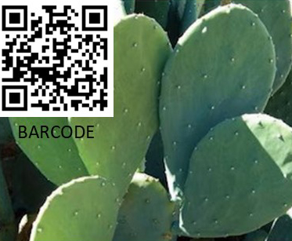

介绍仙人掌酷冷知识

（感谢Etsy提供，若有侵权请告知。）

仙人掌，石竹目，部分仙人掌是灌木或乔木。仙人掌看上去有很多伤人的刺，人们如果接近它，一定被扎到鲜血淋漓，仙人掌不好惹，它是植物界的生存好手。

仙人掌科植物原产地大多在美洲，如今它们已被引植到世界各地。

有些仙人掌长得如几十米巨人，巨人柱仙人掌在沙漠里很有观赏价值。

有些仙人掌没有刺，却进化出了致幻毒素，它为了防止被吃掉，在体内合化出生物碱麦司卡林，具有致幻作用，这在美洲原住民里被使用了几千年。

仙人掌防辐射是彻头彻尾的谎话，电脑屏幕散出的是能量极低的非电离辐射，且直线传播，一盆摆在桌角的仙人掌不能对人体起到防护作用。

仙人掌虽耐旱，可它不都生活在沙漠原野！有些仙人掌长在树上，例如附生仙人掌。

仙人掌的刺其实是叶，它可以帮助降温，是天然的防御工具，能保护自己不被吃掉。

仙人掌的果实不一定都有刺！有些仙人掌果实外皮滑，一些有刺或细小刺毛，仙人掌果是美味，人们用鲜果加工做罐头或酒饮料，如果用它做冰淇淋，风味相当好。

仙人掌的药用价值首先被清代赵学敏所记，他记载仙人掌味淡，具有清热解毒止痛、健脾止泻安神的功能，内服外用可治疗很多疾病。仙人掌可以治疔疮，还可以治疗胃痛腹痛痢疾和哮喘等病，民间常用去刺仙人掌来外敷以缓解局部疼痛或轻度烫伤。

（感谢ChatGPT介绍仙人掌酷冷知识，若有侵权请告知。）
