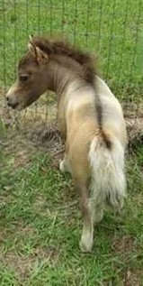

介绍侏儒马………

(感谢搜狐提供上图，若有侵权请告知。)

侏儒马和马匹侏儒症马有很大差异，侏儒马健康，身体结构匀称且协调。马匹侏儒症可能由近亲繁殖等不当繁育方式引起，这是罕见遗传疾病，马得此病概率在百万分之一。

广西果下马又称马里熊猫，是侏儒马源流之一。汉宫侏儒马是汉代果下马的后裔，一般在106厘米以下，优质侏儒马仅60至90厘米，大多分布在江苏沛县，目前在西南马里仍然存在着106厘米以下的小型马。设特兰小马产在英国苏格兰的设特兰岛，
设特兰侏儒马的历史可追溯到青铜器时代，19世纪，设特兰侏儒马因骨骼粗壮体力惊人，被大量用在煤矿运输和驮马劳役用途上。目前，此状况发生了转变，侏儒马多用在宠物辅助疗愈或旅游打卡互动等项目上，它不仅可用来观赏娱乐和实验考古，
且是妇女和老年人或儿童的好朋友。英国一匹患有侏儒症的小马，仅51厘米左右，因其独特外表被人们视作侏儒马明星。

在外表结构上，侏儒马一般头小额宽，身体结构结实，背部短宽且肌肉发达，被毛丰富浓密。马匹侏儒症马脖子短，鼻孔在鼻子顶上，腿弯曲，它还可能患有呼吸和关节以及心脏疾病。市场售卖的侏儒马分进口和国产，价格在5000元至5万多元不等。
进口设特兰矮马价格在1万多到5万多元左右，国产德保矮马价格相对便宜，在1万元以下。以上价格仅供参考，实际以买卖时市场价格为准。马易因外界刺激受惊。在公共地域牵马遛马，一旦冲撞行人或车辆，饲养人将依据《民法典》承担无过错侵权责任，
需对造成的人身伤害和财产损失承担赔偿，若后果严重还可能涉及刑事风险。饲养者应遵守法规，切勿在马路等公共地域违规饲养或遛马。如确需饲养，应挑选具备合法资质的专业马场。

(感谢库库介绍侏儒马，若有侵权请告知。)
