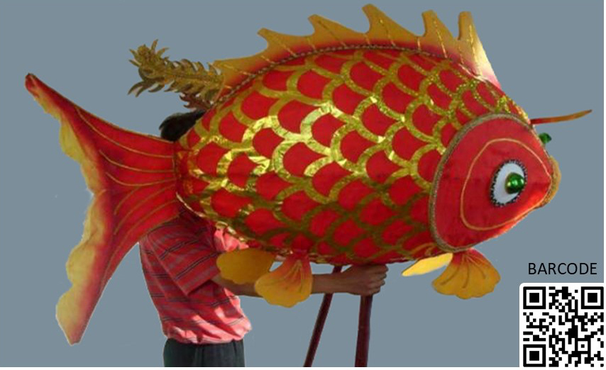

介绍山东烟台鲤鱼灯.........

shorturl.at/pMUZo

鲤鱼灯，山东省烟台市传统民俗，我国非物质文化遗产之一。鲤鱼灯产生在宋初，至今已有一千多年历史。古代乡野劳动人民用鲤鱼灯来庆祝来年田野出产丰收富裕，有年年有余之意味。鲤鱼灯因持鲤鱼形状的灯得名，常在年节期间用来闹春。 鲤鱼灯独特优美朴实价廉物美，以竹篾编扎外形框架，
用纱布或绵纸蒙壳，通体贴上层迭鱼鳞，头尾可活动。当艺人用鲤鱼灯欢庆时，可见鲤鱼轻盈游动栩栩如生。民间以唢呐曲牌和打击乐伴奏，气氛非常火热。 勤劳了一年的山东烟台渔民和村民，在渔灯节的几天里喝上一盅酒，品尝自己一年的收获。游鲤鱼灯是一项健康活动，
丰富弘扬了民族文化，增多了春节喜乐气氛，给乡野村民们带来美好的祝福。

（感谢百度百科介绍山东省烟台市鲤鱼灯，若有侵权请告知。）
