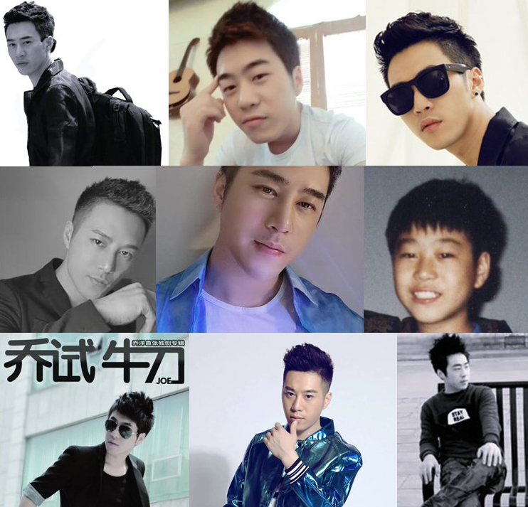

介绍流行乐歌手乔洋

（感谢各网络提供上图，若有侵权请告知。）

乔洋，1990年生在河南省商丘市，内地流行乐男歌手，词曲创作人和音乐制作人，代表作品有《卑微的承诺》、《你的烂借口》和《结局后才明白》。网易评价乔洋的嗓音温馨脱俗可爱俏皮，极易让人受到感染，所创作的歌曲让人钦佩不已。
乔洋自小拥有敏锐听力，在没有指导培训的状况下自学了钢琴、古筝、吉他和架子鼓等乐器，少年乔洋运用自学来的音乐功底，很快便掌握了编曲这受用一生的技能，他在电脑音乐兴起时代创作且发布了多首广受年轻听众喜爱的原创歌曲。

当他的妈妈听到周围邻居向她夸赞乔洋发布到网络上的歌曲很好听时，妈妈才意识到自己的儿子有音乐天赋的一面。

2005年，15岁的男孩乔洋出品第一首原创单曲《棉花糖男孩》。然后，他又出品单曲《我们最屌》。2009年3月，萤火虫电台专访乔洋，2009年6月，酷狗电台专访了乔洋。一年后，天才歌手乔洋再次敲击华语乐坛，他的单曲《卑微的承诺》和《不是爱神》风靡一时。
次年，乔洋出品单曲《不存在的永远》和《结局后才明白》，他正式签约竹书文化，且在年底出品单曲《小刺猬》和专辑《你的烂借口》及《当我遇见你》。 来年初，他发布单曲《樱桃好吃》和《离水的鱼》， 且独立出品首个实体自创作专辑《乔试牛刀》，在年底他又出品单曲《蜡笔没了小新》。一年后，他和竹书文化解约恢复自己独立音乐人身份，组立乔洋工作室 ，自我定位且开始不间断地推出新作品，他以独立音乐人的身份融入了流行乐界。在一年时间内，他发布了专辑《乔洋2.0》 、单曲《那么糟糕》和《Baby boy》。2015年，乔洋加入音乐创作职业队 - 秀天下，师承著名音乐人陈秀男，且在6月出品单曲《狼道》，打造了不一样的乔氏摇滚。2017年，乔洋出品单曲《了不起》。目前，由乔洋作曲自唱的《一半清醒一半醉》歌曲被广泛流传，受到听众一致好评。娄底新闻评价乔洋声音淡雅清新，不骄不躁的品质成就了乔洋在音乐创作上的温和，乔洋可以掀起90后音乐潮，创下90后独立音乐人人气的典范。音乐潮流再改变，创作艺人的风格却不可能抹灭这位乐坛90后词曲创作人乔洋。

（感谢百度百科介绍词曲创作人乔洋，若有侵权请告知。）
