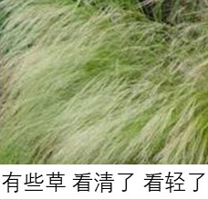

介绍羽毛草养植指南

羽毛草，起初产在亚洲的多年生草本植物，此植物以其长如羽毛状的芒得名。羽毛草户外尺寸30-90 厘米，这使它具有独特外表。羽毛草每天至少需要6小时的太阳照射。因此不适合室内养植。
羽毛草耐旱，不需要特殊的湿度条件。羽毛草耐热耐寒且不需要肥料，羽毛草一般无病虫害，有些易患锈病，羽毛草相对容易生长，不需要修剪，只需最少维护。

（感谢Plantsnap介绍羽毛草养植指南，若有侵权请告知。）
