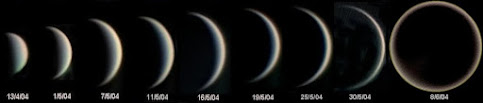

地球的姐妹星 - 金星30亿年前可能存在过生命

https://shorturl.at/gIprF

金星被称为地球姐妹星，它俩无论个头大小、体积质量或天体位置，都很像，而且金星距离地球近，可金星上温度吓死人，表层大气压能直接压跨站上去的人。金星上充满了火山，金星表面有 900 多个丰富独特的大型火山坑和撞击坑。著名物理学家霍金说过，
地球很有可能是下一个金星，很多科幻作品里将金星描述成宜居星球，其实是把金星的过去展示在了人们面前。那么金星能不能拥有过类似地球的资源和生命？它过去到底发生过什么灾难？人们在不断地探索著这个奇特行星，希望能够发现它所隐藏的秘密。

金星上有很多金字塔

从探测器传回的图片可以看到，大量城市废墟屹立在金星表面，被火山泥石流覆盖淹没了。科学家们分析认为，这些神秘建筑有几万座，而且那些城市废墟都是金字塔型建筑。这些人造怪异形状似乎就是古城市的聚落结构，这些建筑物遍布金星表面，而且常有光亮。
金字塔是人类文明遗迹，那么可以推论，金星在很久以前可能存在着生命和文明。还有猜测说，这些金字塔还可能连结著神秘通道，可通往地下可生存居所，生活在里面的金星人可以很好地隔绝外面热量和气压。

科学家在金星云层里找到了磷化氢，而磷化氢来源的最佳解释是有生命存在。金星上难道有过生命？在科学不断探测的基础上，不断有一些新推断。有科学家相信，在太阳系初始，生命所需已存在金星上，这颗行星就如初始地球一样，成为整个太阳系最早可能有生命的一个星球。

他们相信金星在30亿年前适合生存，在太阳辐射较弱时期，金星表面温度宜人，它拥有海洋和大气层的时间大约有30亿年之久，当时是一个舒适稳定的宜居星球。在数十亿年的漫长岁月里，金星极可能存在智慧生命，且发展出一个高度发达的文明，留下了一些文明遗迹，
或许正是当时的文明建立起了这个类似于金字塔建筑。所以有一种说法，金星或许类似三十亿年前的地球。可后来随着这个行星发生的变化，使得生活在这个行星表面上的生命被毁。

金星上发生过啥灾难

那么金星上到底发生过什么事情将一切都毁灭了？猜测在至少几百万年以前，金星曾和小行星发生撞击，导致火山爆发，才让金星变得越来越热，越来越令人恐惧。俨然已成为外星生命代言人的美国人谢尔登 尼顿提出，在远古宇宙，正负生命发生过无数次残酷战争。
正负方面的神都向他们的众生发布了预言。预言宣称银河系猎户座边缘的水世界是宇宙最后结束战争和走向和平的关键。于是正负生命都派出各自舰队去搜寻那预言圣地。当天使们把光构成的保护罩拿掉时，一个新太阳系展示了出来。众神们向各自体系的众生们证实了预言圣地。
于是正负双方的生命都发起对太阳系的争夺，战争摧毁了火星上的大气层，蒸干了金星上的海洋，火星和金星上的生命都彻底失去了他们的居所，如今只有地球适合生命居住。金星很可能有类似地震的活动，探测器探测到其潜在的地震活动。金星外壳可能很坚硬，
因此可能以周期地壳重铺如火山喷发等来释放能量，频繁的火山活动被认为是其内部热量散失的方式，这些活动都引起金星震。

神秘的金星人

不过或许很多行星上目前还有生命和文明，只是人类只看到了它们荒芜的一面，看不到他们生活的真正空间。生活在美国的敖尼克在挪威世界UFO会议上就发表了此观点。她说自己出生在金星的高纬度空间，金星的星光层，是金星的另一个空间，目前人类还无法接触到此空间。
因此，人类在探测金星时，认为这是一个没有生命的行星。敖尼克描述高维度的金星生活简直如天堂一般。他们用心灵感应在星光层进行互动。最让人吃惊的是，他们可以用思维来创造一切，包括房子等，金星人科技先进，他们直接从周遭吸取能量，这些能量来自造物主。

（感谢希望之声提供以上信息，若有侵权请告知。）
