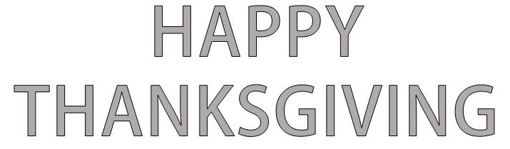

感恩节历史意义

THANKSGIVING

The American Thanksgiving history goes back to early settlers know as Pilgrims. It had been a difficult year for them. The survivors in Massachusetts had a successful harvest thanks to the help of the Wampanoag people. 
A man named Squanto played a huge role by teaching the settlers how to plant corn. In order to celebrate, settlers and Wampanoag people including their leader Massasoit had a feast. Although we think of it as a friendly dinner, 
it was actually a diplomatic alliance—a treaty between two different nations to help protect and support one another. 
For a long time after that, Thanksgiving wasn't a set holiday like it is now. Different towns would just choose a day to give thanks whenever something good happened. 
This changed because of a determined woman named Sarah Josepha Hale. She was a famous magazine editor who spent many years writing letters to different presidents, arguing that the whole country should celebrate on the same day. 
She believed that a national day of thanks could help keep the United States together, especially as the North and South were starting to move toward a massive conflict. Finally, President Abraham Lincoln listened to Sarah's idea. 
He officially declared Thanksgiving a national holiday, hoping it would help heal a country that was literally fighting itself. Currently, Thanksgiving is a time for parades, commercial spectacle and big family meals. However, 
it’s also a time for reflection. Although many people focus on the feast as a symbol of cooperation, 
many Native American groups use the National holiday to remember the difficult history and the loss of land and culture that happened in the years following that first harvest meal. 
Learning both the celebration and the struggle helps us see the full image of American history. 
Thanksgiving is a time to celebrate the harvest and things we are thankful for. We hope everyone and your family has a safe and peaceful Thanksgiving!
